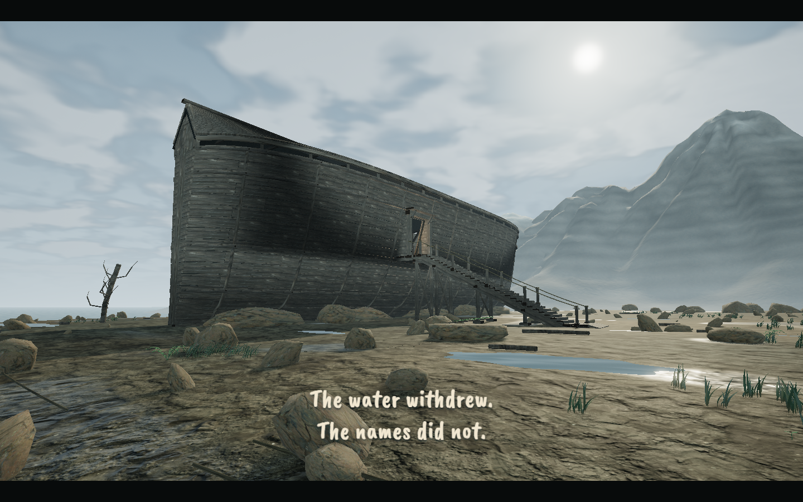
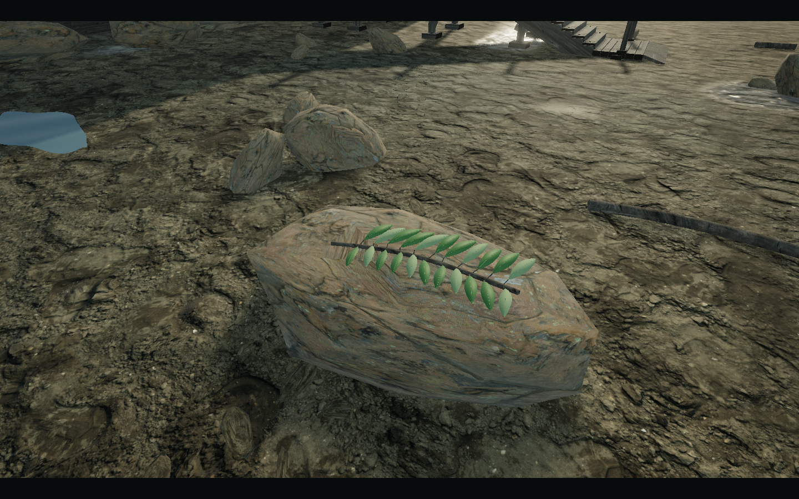
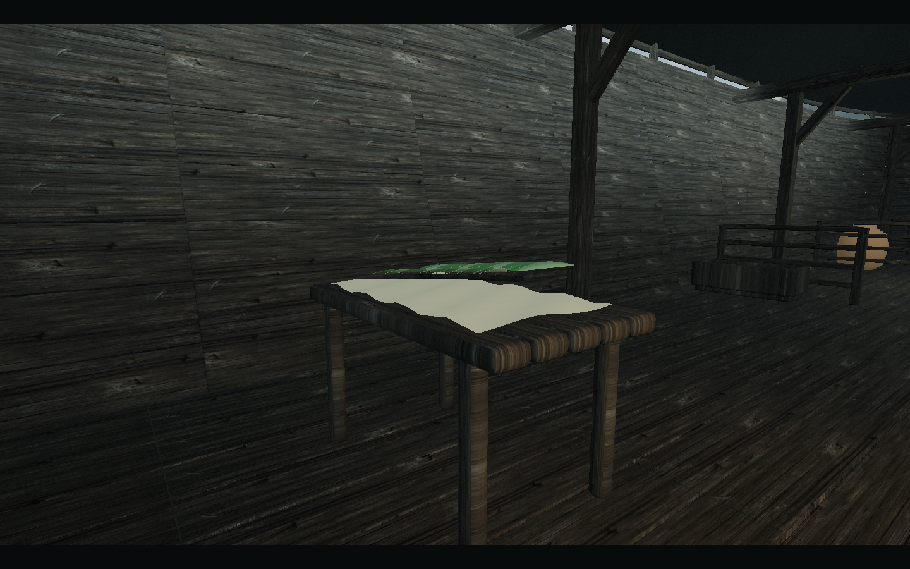
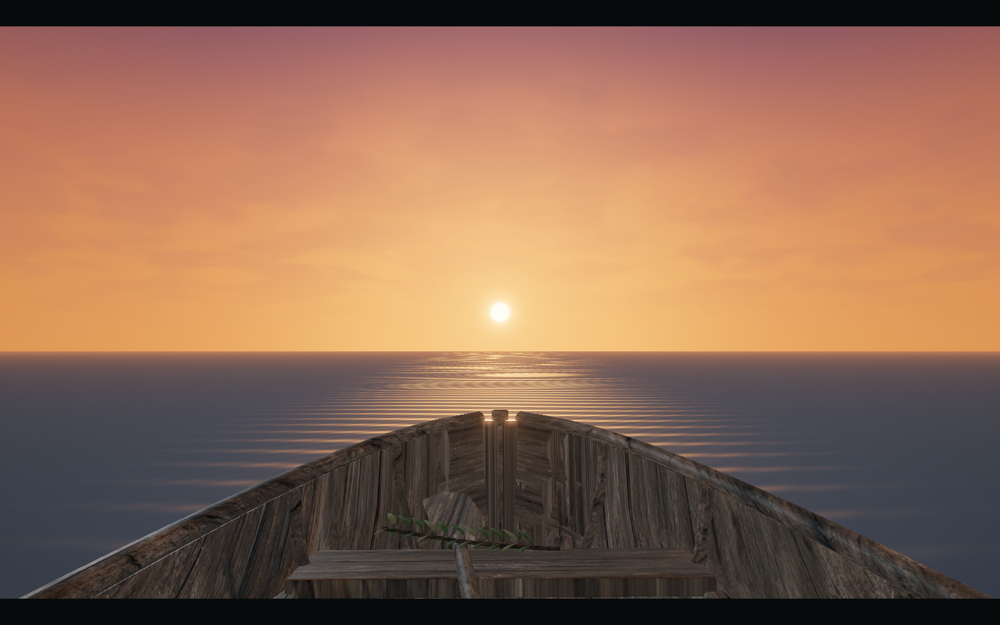

# ARARAT — The First Earth

*The water withdrew. The names did not.*

**[Enter the world →](https://noahisarider.github.io/ararat/)** · [Download the Blender scene](https://github.com/NoahIsARider/ararat/releases/tag/v1.0.0)

[](https://noahisarider.github.io/ararat/)

An original explorable visual novel set on the newly exposed earth after the flood. The enormous cedar hull, ochre-grey sediment, olive cutting and single shore boat frame a story of redemption and self-exile: we never arrived at the promised land. Biblical imagery is interpreted artistically; this is not an archaeological reconstruction.

The mountain pass adds six individually shaped massifs with broad summits, fractured secondary ridges, erosion gullies, alternating rock strata and irregular pockets of lingering snow. They are an artistic interpretation rather than a survey of the real mountain. Sparse sedge islands, curved fern fronds, opposing cotyledons and moss fitted to stone surfaces suggest life returning to sheltered ground. The surrounding bare earth is intentional.

The atmosphere aims for the stillness of a world washed clean: cold sky bounce, a restrained break in the storm, pewter water, damp grey ochre and a little warmth at the ark's threshold. The sense of the sacred comes from scale, light and fragile new growth. In the final departure the sea turns orange-red and gold beneath a setting sun. Thick, rough handwritten English prose floats directly over the landscape, with no scroll, paper, dialogue panel, border or modern buttons.

## Glimpses of the world

| A fragile beginning | What the ark remembers |
| --- | --- |
|  |  |
| Search the washed earth for a sign of life. | Step inside the cedar hull and uncover the memories left behind. |



*Beyond the shore, redemption and self-exile share the same horizon.*

These are in-browser captures of the playable exhibition. Walk freely, discover three memories, then choose to leave the shore.

## Open the landscape

[Enter the exhibition](https://noahisarider.github.io/ararat/). The editable Blender project and browser GLB are available from [Release v1.0.0](https://github.com/NoahIsARider/ararat/releases/tag/v1.0.0); the large binaries are excluded from Git history.

For local development, download `ararat.glb` from that release into `public/assets/`. Download `ARARAT_The_First_Earth.blend` into `blender/` to edit the source scene. Alternatively, run `gh release download v1.0.0 --repo NoahIsARider/ararat --pattern ararat.glb --dir public/assets` after cloning. Pages automatically downloads the pinned GLB at build time and serves it from the same site as the exhibition.

Use a current desktop browser with WebGL 2 and a mouse. Run `pnpm install`, then `pnpm dev`. Open the local URL printed by Vite. The opening view fades into a handwritten prologue, without a modern menu.

- Click the landscape to capture the mouse and start the original synthesized ambience.
- **W A S D** or **arrow keys**: walk. **Mouse**: look.
- **Shift**: walk faster. **Escape**: release the mouse.
- **E**, near the shore olive branch, interior linen table or knotted rope: read a memory. Some memories also surface when approached closely.
- **Click the floating prose**, or press **E / Space / Enter**: continue the passage. Click the landscape again to resume mouse control.
- Passages dissolve slowly in place. Let a fade finish before continuing; repeated input during a dissolve does not skip passages.
- After discovering all three memories, return to the shore boat and press **E** to depart. The boat carries the survivor toward the orange-red sunset and the final handwritten passage.

The walkable route runs from the shore offering stone to the timber stair, through the eastern doorway, then past the linen table and knotted rope into the empty stalls. Return to the waterline for the final departure. After the last passage, the sunset holds briefly, fades to black, and dissolves back into the opening with memories and the boat reset. The loop does not reload the scene. The intended experience is quiet, slow and without a HUD. See `STORY.md` for the original story design. Refreshing the page also starts a new reading.

The second structural revision replaces the original inclined gangway with a 28-step timber stair: approximately 174 mm rise and 357 mm going, level treads, closed risers, notched stringers, braced bearing frames and pads seated in the silt. A short upper landing joins the hatch coaming to the deck at 4.97 m. Handlines are lashed to posts and jambs. The narrowing deck, lower hull, transoms, gables, roof ties and eave supports use the same hull profile. The narrow clerestory openings beneath the eaves are intentional windows.

## Blender project

Open `blender/ARARAT_The_First_Earth.blend` in Blender 5.2 or newer. The scene uses metres and has named collections for the ark, interior, shore, mountains, olive branches, lighting and collision planning. The arrival camera, Cycles lighting, physical sky and native volume atmosphere are included. The 2K PBR wood, mud and rock textures are packed into the file, embedded in the GLB and also supplied as JPGs. OpenGL tangent normals and roughness maps are included. Original procedural fallback images are retained as PNGs.

`scripts/build_scene.py` regenerates the source project and `public/assets/ararat.glb` using Blender Python. It resets the scene in its Blender process; run it in a separate background process when preserving another open scene:

```powershell
& 'D:/Program Files/Blender Foundation/Blender 5.2/blender.exe' --background --python scripts/build_scene.py
```

`scripts/rebuild_ark.py` performs the smaller ark-only revision on the existing `.blend`, preserving the surrounding landscape and vegetation. It uses `scripts/ark_structure.py`, also called by the full generator. It exports `public/assets/navigation.json` from the actual stair/platform/deck dimensions, checks the solidified lower-hull skin, step levels, outward tread normals and footing contact, then saves and exports the revised scene. Its results are recorded in `artifacts/structure-verification.json`.

The `.blend` preserves individual planks, ribs, props and editable curves. The browser resolves the exported geometry and batches compatible materials at load time. The GLB uses glTF's Y-up coordinates; Blender uses Z-up. Browser atmospheric sky, animated water, film grain, ambient sound and locomotion are runtime effects in `src/main.js`, not baked into the modelling file.

`scripts/render_preview.py` produces a fast native Eevee image in `artifacts/blender-preview.png` without changing the saved Cycles project settings. `scripts/render_cover.py` is an optional Cycles render; volumetric clouds can be costly. The browser captures and the native preview use different renderers and are identified separately in the audit.

## Build and verify

`pnpm build` creates a static site in `dist`. It must be served over HTTP. `pnpm verify` checks all stair heights, platform joins and deck/guard boundaries, then exercises the local preview at port 5174. It saves fifteen environment captures, including the stair, hatch, bow, stern, roof and shore boat. It tests real keyboard walking at arrival and a complete stair/interior/stair return, plus continuous route logic. `pnpm verify:story` separately checks the brush font, memory pages, locked early departure, actual boat movement, sunset and ending; it uses inspection positions to reach memories and accelerates the voyage for the final captures. `pnpm test` runs both suites. Evidence is in `artifacts/verification.json` and `artifacts/story-verification.json`. Set `ARARAT_URL` for another local URL. The scripts use the locally installed Chrome executable; adjust it for another machine.

## Production status

This is an explorable environment prototype and a Blender source handoff, not a Steam release candidate. The visual reference is the intimate environmental storytelling of *What Remains of Edith Finch*. No claim of equivalent shipped-game polish is made. See `ART_AUDIT.md` for the independent review.

Before integration into a production game, create engine-specific collision meshes and LODs, consolidate the supplied texture sets into the project's texture budgets, replace the prototype movement controller with the game's capsule controller, validate lightmaps or the chosen realtime lighting system, and profile on target hardware. Steam packaging, controller support, accessibility options, save systems and an engine project are not included in this environment study.

All geometry, generated fallback images and synthesized sound are original project assets. The final close-view PBR materials use CC0 photographic scans from Poly Haven; see `ASSET_CREDITS.md`. No downloaded models, source-game assets or external audio are included. Three.js, Vite and the test tooling retain their respective package licenses.
